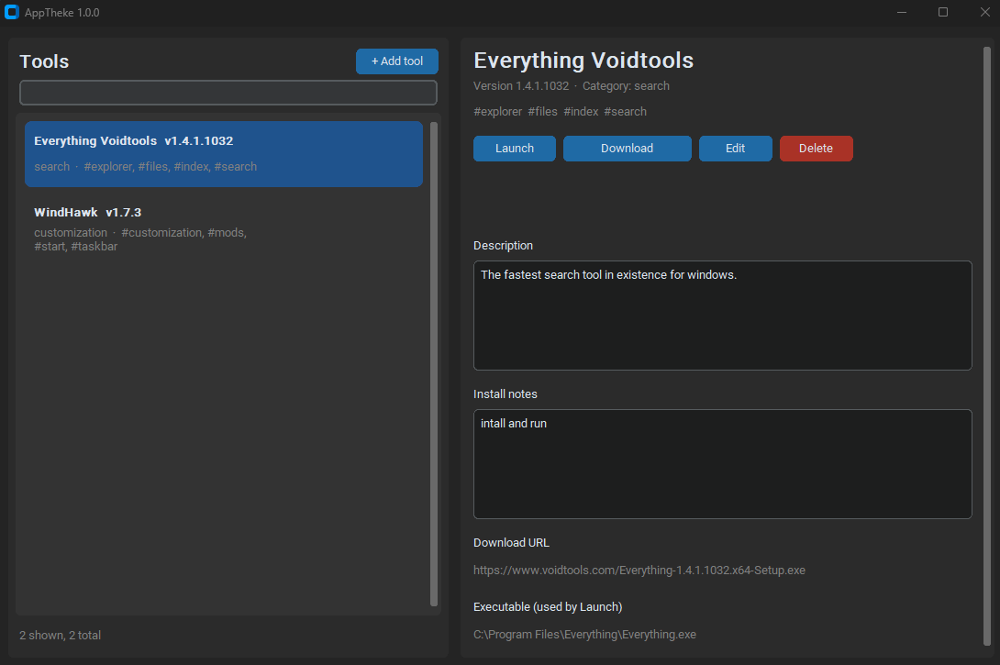

# AppTheke
> From the ancient Greek θήκη (thḗkē), a chest, case, or repository.

A personal catalog for the tools and apps you want to keep close: store them with notes, download their installers from a link you saved, and start them from one window. Websites you use as tools get their own tab, like bookmarks that live in the app.



AppTheke is a **portable Windows program**. There is nothing to install: it is a single `AppTheke.exe`, and everything it stores sits in the same folder, so you can keep it on a USB stick and take it with you.

> **Status:** version 1.0.0, the first release. Windows only for now. A self-hosted web version is planned.

> **AI disclaimer:** this project was built with use of AI. See [AI disclaimer](#ai-disclaimer) before you rely on it.

## Features

- **Catalog your tools.** Each tool has a name, version, description, install notes, a download link and the path of the installed program.
- **Organise them.** One category per tool, and as many tags as you like.
- **Search** the list by name while you type.
- **Download** a tool's setup or executable from its saved link, into a folder you choose, with a progress bar.
- **Launch** installed programs straight from the AppTheke window.
- **Websites tab.** Keep web tools (converters, references, dashboards) next to your programs, with their own category, tags and notes, and open them in your browser with one click.
- **Icons.** Every entry can have an icon: taken from the program itself, fetched from the website, or any picture you choose. Entries without one show their first letter.
- **Portable.** The catalog is one file next to the program. Copy the folder and everything comes with it.
- Follows the Windows light or dark setting.

## Getting started

### Use the ready-made program

1. Download `AppTheke.exe` from the [Releases](https://github.com/JamyPut/AppTheke/releases/latest) page of this repository.
2. Put it in a folder you can write to, such as `Documents\AppTheke` or a folder on a USB stick. Avoid `Program Files`: Windows does not let programs save files there, and AppTheke needs to save its catalog next to itself.
3. Double-click `AppTheke.exe`.

Windows SmartScreen or your antivirus may warn about the file, because the program is not code-signed yet and packaged Python programs are often flagged by mistake. If you trust the source, choose **More info**, then **Run anyway**. You can also run it from source (below) and read the code first.

### Run it from source

You need Python 3.12 or newer on Windows.

```powershell
# create a private Python environment for this project in the folder .venv
py -m venv .venv

# switch the terminal to that environment
.venv\Scripts\activate

# install the packages listed in requirements.txt
pip install -r requirements.txt

# start the app
python main.py
```

## Using AppTheke

| I want to... | Do this |
|---|---|
| Switch between programs and websites | Use the **Apps** / **Websites** tabs above the list |
| Add a tool | On the **Apps** tab, click **+ Add**, fill in the form (only the name is required), click **Add app** |
| Add a website | On the **Websites** tab, click **+ Add**, enter a name and its address (`https://` is added if you leave it out), click **Add website** |
| See the details | Click an entry in the list on the left |
| Change or remove an entry | Open it, then click **Edit** or **Delete**. Delete only removes the catalog entry, never your files |
| Download a tool | Open it and click **Download**, then choose a folder. The tool needs a download link, and the link must point directly to the file, not to a web page |
| Start an installed tool | Save its program path (use **Browse...** in the Edit form), then click **Launch** |
| Open a website | Open it and click **Open website**. It opens in your default browser |
| Set an icon | In the form, click **Choose picture...** (PNG, ICO, JPG, GIF or BMP), or **From program** / **Fetch favicon** to find it automatically. A new entry saved without an icon gets one looked up automatically |

### About program paths

The path you save for **Launch** can be:

- a full path: `C:\Program Files\7-Zip\7zFM.exe`
- a path with a Windows variable: `%ProgramFiles%\7-Zip\7zFM.exe` (works on any PC, wherever Program Files is)
- a path relative to the AppTheke folder: `tools\mytool\mytool.exe` (keeps working when you move the folder to another drive)

### Where your data lives

Everything is stored next to `AppTheke.exe`:

| File or folder | What it is |
|---|---|
| `apptheke.db` | Your catalog, including the icons. **Copy this file to back it up** |
| `downloads\` | The folder the Download window opens in first. Created when needed |
| `apptheke-error.log` | Written only when something goes wrong. Attach it to a bug report |

## Safety

AppTheke downloads files from links you enter and starts programs from paths you save. It does **not** check that a download is safe or unchanged, and it starts whatever file the saved path points to. Only add links from sources you trust, and scan downloaded installers as you normally would.

Two things happen in the background that are worth knowing about:

- **Fetching a website's icon** connects to that website (its page and its `favicon.ico`), and to nothing else.
- **Reading a program's icon** runs Windows PowerShell for a moment, because that is how Windows hands out a file's icon. Some company PCs block PowerShell; the entry then simply shows its first letter.

Websites can only be opened with `http://` or `https://` addresses, so a saved entry can never point to a file on your PC or run a script.

## For developers

### Project layout

```
apptheke/
├── main.py            # entry point
├── core/              # logic without any window code (reused by the planned web app)
│   ├── database.py    # SQLite catalog: apps and websites, categories, tags, icons
│   ├── downloader.py  # downloads a file from a URL
│   ├── launcher.py    # starts an installed program, opens a website
│   ├── urls.py        # checks and cleans up web addresses
│   ├── icons.py       # turns any picture into a 64x64 PNG icon (Pillow)
│   ├── exeicon.py     # reads a program's icon (Windows)
│   ├── favicon.py     # finds a website's icon
│   ├── errorlog.py    # writes apptheke-error.log
│   ├── paths.py       # keeps data next to the program (portable)
│   ├── splash.py      # closes the splash screen
│   └── version.py     # the version number
├── gui/app.py         # the window (CustomTkinter)
├── assets/            # icon.png (source) and icon.ico (the app icon)
├── tools/make_icon.py # rebuilds assets/icon.ico from assets/icon.png
├── tests/             # automated tests
├── splash.png         # the splash screen picture
├── build.bat          # builds AppTheke.exe
├── roadmap.md         # planned work and parked ideas
└── CHANGELOG.md       # what changed in each version
```

### Run the tests

```powershell
# -m unittest: run Python's built-in test runner
# discover:    find the test files by itself
# -s tests:    look inside the tests folder
# -t .:        treat the current folder as the top of the project, so tests can import core
python -m unittest discover -s tests -t .
```

### Build the .exe

With the environment active (see above), run:

```powershell
build.bat
```

PyInstaller bundles Python, the libraries and the code into `dist\AppTheke.exe`. The script runs this command:

```powershell
# --noconfirm:               overwrite the previous build without asking
# --clean:                   clear PyInstaller's cache first
# --onefile:                 produce one .exe instead of a folder of files
# --windowed:                no black console window behind the app
# --splash splash.png:       show this picture while the .exe unpacks itself
# --icon assets\icon.ico:    the icon Windows shows for AppTheke.exe
# --add-data "assets\icon.ico;assets": bundle the icon so the window can use it too
# --name AppTheke:           name of the output file
# --collect-all customtkinter: include CustomTkinter's theme and font files
pyinstaller --noconfirm --clean --onefile --windowed --splash splash.png --icon assets\icon.ico --add-data "assets\icon.ico;assets" --name AppTheke --collect-all customtkinter main.py
```

### Change the app icon

Replace `assets\icon.png` with your own square picture (at least 256 x 256 pixels), then run:

```powershell
# rebuilds assets\icon.ico, with every size Windows needs (16 to 256 pixels)
python tools\make_icon.py
```

and build again.

The single-file build unpacks itself on every start, so launching takes a few seconds.

### Contributing and ideas

New ideas go in [roadmap.md](roadmap.md) first. Changes worth knowing about go in [CHANGELOG.md](CHANGELOG.md).

## AI disclaimer

AppTheke was built with use of AI. Most of the code, the tests and this documentation were written by Claude.

- **AI-written code can contain mistakes**, including ones that are easy to miss. Automated tests cover the core logic (the database, downloading and launching), but the project has not had an independent code or security review.
- **The app downloads and starts programs**, so a bug here matters more than in most small tools. Read the code before you rely on it for anything important, and keep a backup of `apptheke.db`.
- **No warranty.** The software is provided as is, and its author is not liable for damage or data loss from using it.

## License

GPLv3. See [LICENSE](LICENSE).
